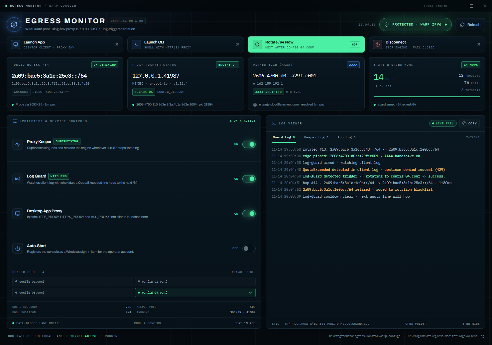

# Egress Rotator & Monitor

A local Windows control console for a pool of Cloudflare WARP WireGuard configs. It runs a userspace
`sing-box` proxy on `127.0.0.1:41987`, rotates the egress IPv6 /64 on demand, and hops automatically
when `client.log` reports `QuotaExceeded`.



> The screenshot above is a UI capture with demo data. Live addresses, hops, and log lines come from
> the engine and the egress probe on your machine.

## How it works

```text
React renderer (Tailwind) ── IPC ── preload bridge ── Electron main
                                                         │
                             ┌───────────────────────────┼──────────────────────────┐
                             │                           │                          │
                       ConfigPool                  EngineManager                LogGuard
                  warp-configs/*.conf          sing-box child process       chokidar on client.log
                             │                           │                          │
                             └──── render config ────────┘                    "QuotaExceeded"
                                       runtime/sing-box.json                       │
                                                                                   ▼
                                                                              rotate /64
```

A hop is:

1. `LogGuard` reads only bytes appended to `client.log` after the guard was armed and finds
   `QuotaExceeded`.
2. Cooldown is checked (default 75 s), then rotation starts.
3. The next `.conf` in natural filename order is rendered into a sing-box config
   (`runtime/sing-box.json`). Private keys never leave the main process.
4. The old engine is stopped (`taskkill /T /F`), the new one is spawned, and the app waits until
   `127.0.0.1:41987` accepts connections.
5. Egress is probed through the SOCKS5 proxy, the new /64 is recorded, hops/blacklist counters move,
   and the receipt is written to the Guard log:

   ```text
   11-14 08:11:52 log-guard detected trigger -> rotating to config_04.conf -> success.
   ```

   A listening port alone is not treated as success: if the probe fails the log says
   `tunnel listening but egress unverified` and the status stays `DEGRADED`, because sing-box can bind
   the inbound and still report `no route to internet`.

## Requirements

- Windows 10/11
- Node.js 22+ and npm
- `sing-box` 1.10 or newer (1.11+ preferred; the renderer detects the version and falls back to the
  legacy outbound format)
- Cloudflare WARP `.conf` files (WireGuard format)

No administrator rights are needed: sing-box runs in userspace and exposes a local SOCKS5/HTTP proxy.

## Quick start

```powershell
cd control-deck
npm install
npm run engine:fetch          # downloads sing-box.exe into engine\
# copy your WARP configs into warp-configs\config_01.conf … config_04.conf
npm run dev                   # Vite + Electron with hot reload
```

Or double-click **`Buka Egress Monitor.bat`** in the project folder to build and launch the desktop
window directly.

Production-style launch:

```powershell
npm start                     # builds the renderer, then opens Electron from dist\
```

On first run the app creates `settings.json`, `logs\`, `runtime\`, and `workspace\`.

### Scripts

| Script | What it does |
| --- | --- |
| `npm run dev` | Vite dev server + Electron |
| `npm run build` | Production renderer build in `dist/` |
| `npm start` | Build, then launch Electron |
| `npm run engine:fetch` | Download `sing-box.exe` for this machine |
| `npm run test:backend` | 21 backend checks (parsing, guard, engine, rotation) |
| `npm run test:logbus` | Self-check for `LogBus.clear()` truncation |
| `npm run preview` | Serve the built renderer in a browser (no IPC bridge) |

## Where the WireGuard configs go

Put the `.conf` files in the pool directory — by default `control-deck\warp-configs\`:

```text
warp-configs\
  config_01.conf
  config_02.conf
  config_03.conf
  config_04.conf
```

- Files are sorted naturally (`config_2` before `config_10`), rotated round-robin, and wrapped.
- Any file whose name does not end in `.conf` is ignored.
- Malformed files are rejected and reported in the App log; the rest of the pool keeps working.
- Point the console at another folder with **Change folder** in the Config Pool section, or edit
  `poolDir` in `settings.json`.

A WARP config looks like this (values from your own WARP export — never commit them):

```ini
[Interface]
PrivateKey = <your private key>
Address = 172.16.0.2/32, 2606:4700:110:8d3e:.../128
DNS = 1.1.1.1, 1.0.0.1
MTU = 1280

[Peer]
PublicKey = bmXOC+F1FxEMF9dyiK2H5/1SUtzH0JuVo51h2wPfgyo=
AllowedIPs = 0.0.0.0/0, ::/0
Endpoint = engage.cloudflareclient.com:2408
```

## Settings

`settings.json` is created on first launch. Paths may be relative to the console home. Restart the
app after editing; pool and log folders can also be changed from the UI.

```json
{
  "proxy": { "host": "127.0.0.1", "port": 41987 },
  "engine": {
    "command": "engine/sing-box.exe",
    "args": [],
    "timeoutMs": 15000
  },
  "poolDir": "warp-configs",
  "clientLogPath": "logs/client.log",
  "edge": { "host": "engage.cloudflareclient.com", "prefer": "ipv4" },
  "probe": {
    "urls": [
      "https://api64.ipify.org?format=json",
      "https://api6.ipify.org?format=json",
      "https://api.ipify.org?format=json"
    ],
    "timeoutMs": 9000,
    "compareDirect": true
  },
  "guard": { "cooldownMs": 75000 },
  "keeper": { "intervalMs": 10000, "failuresBeforeRestart": 2, "heartbeatLogMs": 90000 },
  "client": {
    "desktop": { "command": "", "args": [], "cwd": "" },
    "cli": {
      "command": "powershell.exe",
      "args": ["-NoLogo", "-NoExit", "-Command", "..."]
    }
  },
  "workspaceDir": "workspace",
  "autoConnect": true
}
```

### Launch App / Launch CLI

Launch actions read `client.desktop` and `client.cli`; nothing else is spawned from the renderer.

- `client.desktop.command` is empty by default. Set it to your client executable, e.g.
  `"C:\\Program Files\\Client\\Client.exe"`, with optional `args` and `cwd`.
- `client.cli` defaults to a PowerShell window with `HTTP_PROXY`, `HTTPS_PROXY`, and `ALL_PROXY`
  pointed at `127.0.0.1:41987`.
- When **Desktop App Proxy** is on, both launches receive those proxy variables. This is per-process;
  it does not rewrite the system-wide Windows proxy.

### Stats card

`Projects` and `Chats` are read from `workspaceDir\projects\` (subdirectories) and
`workspaceDir\chats\` (`*.json` files). If those folders do not exist the card shows `—` instead of
inventing numbers. Point `workspaceDir` at your client's data directory to show real counts.

## Guard behaviour

- The log file is created if missing and watched with chokidar (`awaitWriteFinish`, 200 ms).
- The guard starts at EOF: pre-existing quota lines do not trigger a hop.
- The first appended chunk containing `QuotaExceeded` triggers; repeats inside `guard.cooldownMs` are
  suppressed and logged once per window.
- The trigger only rotates while the tunnel is connected. When offline, the event is logged and the
  hop is skipped.
- Only triggers that actually cause a hop are counted; suppressed or skipped ones still appear in the
  Guard log but leave `triggers` untouched.
- File truncation/rotation is handled by resetting the read offset.

The watched file is `clientLogPath` (default `logs\client.log`). Point it at your client's real log by
editing `settings.json` and restarting the console; the active path is always shown in the log footer.

## Keeper behaviour

Every `keeper.intervalMs` the keeper checks that `127.0.0.1:41987` is listening. After
`failuresBeforeRestart` consecutive failures it rotates (or reconnects if it was offline). It also
recovers automatically if the engine exits unexpectedly.

The `retired /64` metric counts only configs burned by a quota trigger (`reason === 'log-guard'`).
Operator and keeper hops move the hop counter but are not retirements, and an IPv4 egress has no /64
to record — so a healthy IPv4-only WARP session legitimately reports `retired 0`.

## Verification

```powershell
npm run test:backend
npm run test:logbus
```

The backend suite covers config parsing/validation, IPv6 /64 extraction, both sing-box render formats,
pool sorting, the chokidar guard (including cooldown and no-replay-after-cooldown), log persistence and
rotation, engine start/stop with a stub proxy engine, a missing-binary failure, and a full Deck rotation
triggered by `QuotaExceeded` (asserting the exact success line plus the trigger and retired-/64 counters).

`scripts/fixtures/fake-engine.mjs` is a SOCKS5 stand-in used only by tests.

## Project layout

```text
control-deck/
├─ electron/
│  ├─ main.cjs            # IPC, pool, engine child process, chokidar guard, keeper, probe
│  ├─ preload.cjs         # context-isolated renderer bridge
│  └─ lib/pool.cjs        # WireGuard parsing + sing-box config rendering
├─ src/
│  ├─ App.jsx             # Tailwind dashboard (header, actions, cards, controls, logs)
│  ├─ ErrorBoundary.jsx   # keeps a renderer crash from blanking the window
│  ├─ useDeck.js          # IPC state/log subscription + actions
│  ├─ index.css           # Tailwind theme tokens and console surfaces
│  └─ main.jsx
├─ scripts/
│  ├─ dev.mjs             # Vite then Electron
│  ├─ fetch-singbox.mjs   # engine installer
│  ├─ test-backend.mjs    # backend test suite
│  ├─ test-logbus.mjs     # LogBus.clear() self-check
│  └─ fixtures/           # test-only SOCKS5 engine
├─ engine/                # sing-box.exe + its GPL licence (gitignored)
├─ warp-configs/          # your .conf pool (gitignored)
├─ logs/                  # guard.log / keeper.log / app.log / client.log
├─ runtime/               # generated sing-box.json + persisted counters
├─ screenshots/
├─ DESIGN.md
└─ vite.config.js
```

## Troubleshooting

| Symptom | Fix |
| --- | --- |
| `ENGINE MISSING` pill | Run `npm run engine:fetch`, or set `engine.command` to an existing `sing-box.exe`. |
| `CONFIG POOL EMPTY` | Add `.conf` files to `warp-configs/`; check the App log for rejected files. |
| `DEGRADED · EGRESS UNVERIFIED` | The engine is up but the probe URL failed. Check `probe.urls`, DNS, and the App log. The tunnel may still work. |
| Proxy reachable but app ignores it | The app must honour `HTTP(S)_PROXY` or launch through **Launch CLI**. Updating the system-wide proxy is intentionally not done. |
| Hop does nothing | The tunnel must be connected; the Rotate button is disabled while offline. |
| Port 41987 busy | Another proxy is running. Change `proxy.port` and restart. |

## Operational notes

- Everything runs locally. No telemetry, no remote service, no bundled credentials.
- WARP configs contain private keys; `warp-configs/*.conf` and `settings.json` are gitignored, and
  keys are never sent to the renderer or written to logs.
- Counters, toggles, and the last config persist in `runtime/deck-state.json`.
- The proxy binds to `127.0.0.1` only. Do not expose it on a LAN interface.
